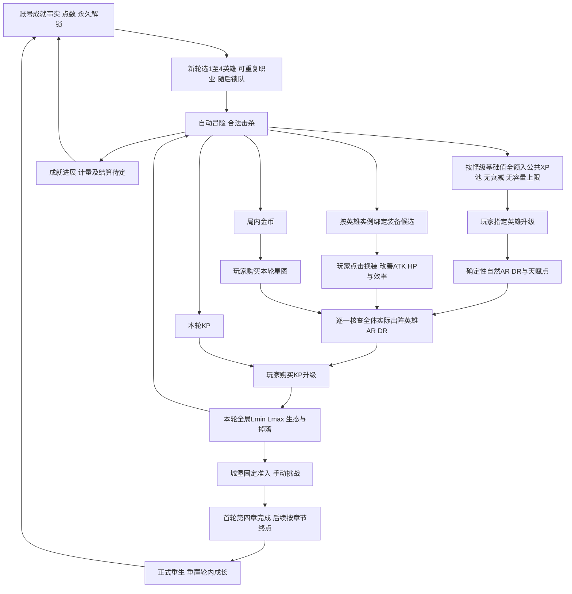

# P2-3-M2 新版产品设计纲要 V1.2（方向基线，非开发授权）

> 当前有效版本：**V1.2，2026-10-25（Asia/Shanghai）**。`FRAMEWORK_REBASED / XP_NO_DECAY_CONFIRMED / M3_IN_PROGRESS / IMPLEMENTATION_NOT_AUTHORIZED`。
>
> 归档仍在 `docs/suggest/`。本轮只同步新版方向与相关文档，不改代码，不开展M3计算或M4审计。来源状态M3_IN_PROGRESS表示策划阶段状态，不代表本轮已运行模型。方向确认不等于完整规格、工程完成或开发任务授权，后续检索不得自动将建议转成必执行待办。

## 本次覆盖、来源与口径

依据 [V1.2输入原件](../temp/P2-3-M2｜新版产品设计纲要%20V1.2.md) 更新同一份纲要；输入SHA256：`39d793973048eea8f7c76a40378e898e1f56b304c44754a9bf4c051853c1f12d`。V1.2优先于V1.1冲突条目，V1.0仅未被覆盖的方向继续有效。历史记录保留于 [模块唯一review](../reviews/2026-10-24_p2_3_content_blueprint.md)，temp原件只读。

关键变化：**无等级差XP衰减，怪物等级基础XP全额入公共池；当前无XP池容量上限，允许长期在线低怪囤XP；怪物XP显著增长与英雄升级成本快速增长须联合推演。** 正向星图/账号经验增益为后续空间，不表示当前已投放。Lv.1怪20XP/Lv.2怪40XP只是示例，不写入配置。容量按最高已领取等级变化仅备用，不能当当前规则实现。

后台运行继续正常生产，不因囤XP问题改为离线计收益；这不取消来源保留的“真正关闭后有限离线结算”方向，具体口径仍未定，也不构成实施授权。原件最后交接标记仍含V1_1，属于版本标记遗留；本归档仅将该标记归一为V1_2，并记录这一修订，不更改输入原件或产品规则。

保留来源13个编号章节、15项覆盖清单和C01～C07；以V1.2改写旧补充中的衰减/反囤经验风险，不将“无衰减”当作已证明升级耗时、击杀能力或不可死锁。

---

## V1.2源纲要（当前方向）

> **文档定位**：供用户、ChatGPT策划和Claude Code执行AI共享的**最新版产品方向认知基线**，更新并覆盖 `Steam_D2_P2-3-M2_新版产品设计纲要_V1.0.md` 中已被新决策推翻的条目。不是开发任务、不是可直接实施的完整数值规格。  
> **版本**：V1.2，2026-10-25（XP规则修订）。  
> **状态**：`FRAMEWORK_REBASED / XP_NO_DECAY_CONFIRMED / M3_IN_PROGRESS / IMPLEMENTATION_NOT_AUTHORIZED`。  
> **最高规则**：用户最新裁决 > 本V1.2已确认设计 > V1.0中未被覆盖且仍有效的设计 > P2历史审计（只负责说明工程事实） > P1历史需求。技术事实不得被策划“确认”替代，策划目标不得被旧工程实现反向替代。  
> **分工**：用户最终裁决；ChatGPT负责提出、反证、验证、维护框架；Claude Code负责在得到明确授权后执行只读工程核查、代码实现、测试和报告，**不得自行补完或更改未定的核心产品规则**。

---

## V1.2变更摘要（优先于V1.1）

- **无XP等级差衰减**：怪物奖励按其等级原值全额进入公共XP池。后续可有正向星图/成就经验增益；不得从旧个人经验规则搬回衰减。
- **怪物XP随等级显著增长，英雄升级XP成本快速增长**：具体曲线进入M3联合推演。
- **无XP池上限**（当前），长期在线低级挂机可囤XP，属于可接受行为；可变容量仅登记为备选。
- **后台连续挂机行为不变**；转离线计收益仅是未来可研究方案，未经批准不得实现。
- V1.1的“XP衰减致KP可达性断链”不再是当前机制的问题；M3必须重新验证正常击杀能力、下一档XP时间和Lmin升档安全。

## 0. 仍按P2-X开发：不单设重生专题阶段

| 原四步路线 | 阶段 | 当前安排 | 本阶段完成定义 |
|---|---|---|---|
| 第一步：设计纲要 | **P2-3-M2 V1.2（本文）** | 已更新；以本文重新同步方向 | 所有主要产品裁决、旧文件覆盖清单和未决边界在同一认知基线内 |
| 第二步：框架推演和数值闭环 | **P2-3-M3（回归主线）** | 继续进行，旧V0.1压力试算仅作参考 | 主动升级、公共XP、等级确定性攻防供给、全局KP、固定编队、轮内收益、章节/重生接口连成可行轨迹；有反例清单及建议 |
| 第三步：工程差异核查 | **P2-3-M4** | M3通过后 | 以最新工程为准，逐组件可继承/需改/待新增与测试切口 |
| 第四步：落地任务及执行包 | **P2-3-M5** | M4完成后 | 明确里程碑、配置、边界、验收、迁移；用户批准后才能实施 |
| 开发与体验回归 | P2-4 / P2-5 | 后续 | 实际编码/自动模拟/实机验收 |

**解释**：重生是对M2原产品框架的修正，并非新增长流程。成就点商店、新职业具体名录、多轮内容投放曲线等先保留功能接口，**不在本步细化为完整设计**。M3需要先检验单轮核心数值与永久循环的兼容性，而不是开发大规模多轮数值系统。

## 1. 核心产品一句话（覆盖V1.0第二节）

> **Steam端自动冒险团队增量RPG：玩家在一轮中选定1～4名英雄（普通编制4槽），自动刷怪获得公共XP、金币、KP和Loot；玩家亲自完成英雄升级、分配天赋、更换装备、投资星图和KP、攻略城堡；完成本轮章节后正式重生，通过账号永久成就点与职业/功能解锁，使下一轮更快、更爽、可尝试新组合。**

- **自动但不自动增强战力**：自动移动/战斗/拾取/常规冒险/收益积累；后台未退出时继续生产；真正退出后按照可结算时长与收益规则结算（原始基础2小时设想，尚待正式数值）；**不得自动替玩家升级、穿戴、花KP或金币、加天赋**。
- **主动转化资源为战力**：升级英雄→自然属性与天赋点；装备一键替换；KP调高怪物等级与掉落；星图增强本轮；药剂主动限时增益，前期卷轴主动补刀，重要城堡/特殊大地图事件手动批准。
- **单轮成长**：英雄等级/技能、装备、KP余额与`[Lmin,Lmax]`、金币、局内星图、章节进度等。上一版所称“KP永久升级”，改为**本轮内永久（不可普通撤销），重生时重置**。不要再称它为账号跨轮永久。
- **跨轮成长**：账号成就记录、成就点余额/可购买永久奖励、新职业与编队规则解锁。跨轮奖励让早期流程更快、更轻松，并提供新构筑空间。
- **正式完整重生**：第一轮到第四章通关即可完成有效轮次，解锁第5章预览并引入下一轮可选新职业；后续轮次开放第5章。首轮及后续轮次都应具有明确终点。跨轮成长系统的**细节设计后置**，但轮次切分和存档归属需在框架中保留。

### 1.1 初始编队与重生

- 游戏初始即有**4个普通上阵槽**，**没有逐人扩编的主线**；第一轮已有可选择的职业池，初期候选约4～5职业（目前既定首批五职业：野蛮人、游侠、法师、圣骑士、死灵法师；具体初始可选集合可由最终内容量决定）。
- 玩家可以选**1～4名**上阵，允许**重复职业**（如双法师、四法师）；每个上阵位置是独立英雄实例，等级、装备、天赋分别保存。重名职业的Buff/光环/召唤物叠加与画面预算需规范。
- **开局锁定本轮队伍**；本轮中途不能新增、移除、换职业；只能放弃/重开本轮（账号成就和永久购买不损失）。不能把“主动换阵容”当成升`Lmin`之后的常见失败场景。
- 4人队是默认关卡和收入平衡基准；1～3人是自愿玩法，未来可由成就奖励支持孤狼等打法；**不默许少人自然等价于满编的战斗效率**。
- 第五个上阵槽不再是本轮星图末期功能：改为**账号成就点商店昂贵的永久商品**，至少达到符合规定的两次轮次通关进度才有资格/资源购买。价格与具体计数规则尚待数值设计；普通平衡不得要求第五人才能通关。

## 2. 核心战斗属性与伤害（V1.0相关规则继续有效）

- **ATK/HP**：控制基础击杀时间TTK与生存能力；固定技能有自动释放时序、冷却、效果、表现预算；不引入力量/敏捷/智力/耐力一级属性。
- **攻击等级AR／防御等级DR**：唯一主要对抗等级，不决定命中；取消常规Armor减伤（这属于策划要求，**未证明代码已改**）。
- DMG1聚合快照，DMG2判定暴击、格挡、闪避及相关事件，DMG3计算攻击力×技能系数×常规合法倍率×AR/DR倍率×对应元素抗性（必要时按分量处理），扣HP后触发事件；细节与旧实现对齐待M4。
- 临时攻防对抗倍率范围`40%～150%`，示例函数`Clamp((AR/DR)^1.5, 0.40, 1.50)` **不是已批准曲线**；暴击默认受评级惩罚，仅少数天赋可获得“暴击绕过评级惩罚、最多恢复到100%”特殊能力。
- 怪物保留身份/适度特色与Boss表现；玩家不是反复换技能装配以解题的传统ARPG。

### 2.1 关键新增：英雄等级必须是KP评级门槛的稳定主来源

- **正式方向**：英雄每次玩家手动升级，按职业及等级确定性获得基础AR/DR自然成长；等级曲线需要承担下一怪物档位门槛的**主要需求，允许有意超出**。不依赖“刷到特定部位/品质装备”，也不依赖星图必须沿推荐路线加点。
- 装备主要提供ATK/HP与TTK、生存效率；可以附带AR/DR，加快准入或提升效率，但**随机装备和星图不应该是正常推进的唯一解锁路径**。
- 可以允许装备提前帮助小队满足KP门槛；正式数值需检验装备被移除、临时药剂过期以及`Lmin`升档安全，不先假定允许的提前程度。
- **KP等级门槛必须逐一检查本轮实际所有上阵英雄的AR/DR**；不能用队伍平均值、最高英雄、人数加权战力分数代替。若只选一个英雄，只检查这一人，但冒险怪物数量/威胁和效率仍需另外检验。
- 职业可由ATK、HP、技能、BUFF等表现不同，**不强迫AR/DR基础成长完全相同**；门槛须对所有合法职业及其组合具有可达路径。

## 3. XP、手动升级与天赋（本节覆盖V1.0的自动个人XP全部假设）

### 3.1 XP归属与消费

- **局内公共XP池**：小队自动击杀怪物，收益进入本轮共享XP余额，**不再是四个英雄各自自动积累/升级**。
- **玩家手动指定英雄升级**：只有玩家点击，才扣公共XP、提高该英雄已领取等级/基础属性/天赋点。升级按钮置于战斗主界面**右侧成长交互区的最高排序级别**（精确队列排序后续单独设计）。
- **自由分配**：可以把XP集中给某个英雄；不做“强制平均等级”约束。各级升级所需XP应显著递增，让边际收益引导理性的队伍成长，是否均衡由玩家决定。
- **最新临时正式基线：完全取消等级差XP衰减**。每次击杀获得该怪级基础XP的100%（未来可受星图/账号永久加成）。怪物等级越高，单杀XP显著增长；单英雄升级所需XP随英雄等级较快增长。具体指数需M3联立推演；示例Lv.1怪20XP、Lv.2怪40XP尚非正式配置。共享XP池允许无限积累，不对长时间在线刷低级怪加惩罚。
- **XP池容量上限只是备用防守方案**，本阶段不启用；若未来确实需要，容量可考虑随队伍最高已升级英雄等级扩大，且不能低于下一有效升级成本。后台运行仍按正常挂机，不因担忧XP囤积擅自切换为离线结算。

### 3.2 天赋和技能

- 每职业**固定4个技能＋1个独立职业特性小树**；基础攻击默认学会，后续技能花天赋点手动学习，学会后自动纳入战斗AI，无主动槽购买/装配。
- 技能分工大致为基础攻、短CD招牌、低频特色/辅助、长CD终极；特性可由局内早期星图解锁，技能各自有多级小树、少量二选一/极少三选一效果分支、离散被动短链。
- 免费改选单点互斥，允许按技能区域免费局部洗点；职业特点与所有技能的表现预算需统一控制。
- 各技能的等级上限、天赋点总供给和解锁等级**须待XP/怪级曲线成立后反推**；局内星图仍可为全部上阵英雄增加额外天赋点，但不自动绕过英雄等级前置。
- 如果任何技能、天赋点或主动升级涉及“回城自动做完”的旧行为，以本版**玩家主动增强**为准。

## 4. KP与怪物等级——仍是单轮进度发动机

- 设账号当前轮次唯一怪物等级区间`[Lmin,Lmax]`（技术上由本轮RunState拥有，具体状态结构由M4确认）；地图、地牢、城堡均以区间生成怪级，初版等概率抽级，无章节独立怪等级权威。
- KP是**本轮可消费**的击杀货币，独立于成就点；提高怪物等级上限/下限、怪物数量、金币/装备/卷轴/药剂掉率、品质分布、特殊怪遭遇等。
- `Lmax`引入更高等级的新怪；`Lmin`淘汰旧等级（本轮内不可随意撤销），两者不可只做同等升档审查。提高等级带来更高等级装备、XP及金币/KP等经济价值。
- 城堡拥有配置的固定怪等级解锁要求，例如Lv.2需求“已解锁Lv.2怪物”；目前最自然解释是`Lmax >= 2`，但**是否附带实际击杀该档怪的证明，尚未获用户定案**。城堡实际遇怪仍遵守统一区间；怪物模板可以因Boss而有额外强度。
- **本轮安全铁律**：任何合法的本轮内不可逆KP升级都不能切断玩家继续获得升级所需资源的可靠途径。由于固定编队+角色等级只升不降，部分旧风险缩小；但仍有洗点、卸装、BUFF失效、1人挑战、XP供应效率不足、怪物模板克制等风险。
- 原M3使用“本档装备＋星图必须满足升下一档”的前提**失效**；不能沿用旧计算结果作为升级可达性证据。必须重建英雄自然AR/DR成长与怪物等级标准的共同标尺。

## 5. 装备、卷轴、药剂与界面操作

### 5.1 装备

- 怪物只掉本轮实际出阵英雄可穿的角色绑定装备；允许重复职业时必须按**英雄实例**绑定，不仅绑定职业名。
- 暂定6～8部位，部位可仅一条主属性；属性等级提升是主要跨度，普通／稀有／罕见／传奇的品质提升提供同级继续追求，上一等级顶级品质可略高于下一等级普通品质。
- 玩家点击右侧更好装备按钮后才实际替换并提升战力。回城自动出售旧件/杂物前先保留每个英雄部位更好的待穿候选，不能因挂机自动错卖。
- 装备**不成为KP评级门槛的唯一可靠来源**；承担大部分基础TTK、HP和一定效率/提早升档。新增的英雄等级对ATK/HP是否有少量自然提升，可与装备贡献账本一起测算，不强行全部留空。

### 5.2 卷轴／药剂

- 约5种卷轴：前期玩家直接介入的单体/连锁/AOE补充伤害，少量BUFF可选；卷轴掉率由KP升级，星图管效果、容量、自动施放；自动使用仍消耗库存，不能成为普通战斗生存必需。
- 药剂作为长期主动操作，创造约十几分钟的战斗/掉落/移动冒险效率窗口。药剂有限槽，捡取占槽、使用中继续占槽、结束后释放；不无上限堆叠或自动覆盖。
- 卷轴、药剂自动产出不得导致**自动永久提升主战力**。暂时的药剂Buff是消耗品行为，不等于英雄自动升级或装备自动更换。

### 5.3 在线／后台／离线

- 单完整Steam窗口，战斗为核心画面；卷轴、药剂、右侧成长操作区域，以及英雄/星图/地图/怪物页面。
- 游戏运行但不在前台：照常自动刷怪积累**未消费资源**；不替玩家主动升级、换装、改天赋、KP/星图购物、发起城堡挑战。
- 真关闭游戏：使用有限离线结算（起步约2小时，相关星图可能加长/提高效率），只给合法可获取资源并尊重库存规则；离线**不推进主动消费类战斗力成长或主动城堡进度**。
- 后续需确定离线XP、装备最佳候选、卷轴药剂和成就点的准确口径；此处仅留框架。

## 6. 星图、成就与重生的双层职责

### 6.1 星图：每轮可重复购买

- 局内金币购买，重生原则上重置；提供本轮ATK/HP/AR/DR等基础增益、全英雄额外天赋点、职业特性区域、卷轴威力/容量/自动施放、药剂能力、离线结算扩展等。
- 如果希望某项功能**跨轮开局即永久生效**，就应把该能力归入成就商店，而不是保留在每轮重置的星图里导致语义冲突。
- 原“第五个英雄位由星图购买”**废止**；改为永久成就商品。
- 星图节点拓扑和单点价格最后设计，不重新进行“星图先行”的旧开发路线。

### 6.2 成就点：账号长期价值（只确认框架）

- 玩家行为和达成事实永久记录；另有成就点作为可积累、可消费的账号永久货币；有效挂机持续带来少量永久价值，章节推进/单轮通关显著提高成就点收益能力（具体计量和防低级挂机刷点规则**后置**）。
- 成就购买界面可以先做简单、**早期全部可见**的商品清单，包括职业、移动/基础效率、槽位/便利、特殊1人队增益以及昂贵的第5英雄槽等候选。
- 跨轮成长**必要设计条件**：①能承担新职业内容持续投放成本；②后续轮次的同一段冒险必须更快、更爽、重复操作更轻，且适时有新的组合与内容，不能只是原样重打。
- 第一次轮次完成（第四章）之后可重生并开放第五章预览、新职业；第二轮起可进入第五章。后续实际成就商品顺序、几轮买得起第五槽、是否限定最多重生次数**留到长期内容/经济设计，不阻塞当前单轮经济与KP级别的验证**。

### 6.3 轮次重置矩阵（设计语义；存档实现仍需审计）

| 数据 | 正式重生后 | 注释 |
|---|---|---|
| 编队英雄实例/等级/XP池/天赋 | 重置 | 下一轮重新选职业与分配XP |
| 本轮装备、金币、KP、`Lmin/Lmax`、地图城堡进度 | 重置 | 重新经历增量成长；必须避免旧存档混淆“永久KP” |
| 本轮金币星图 | 重置 | 永久功能请转移到成就商店 |
| 账号成就事实、成就点余额、已购永久商品 | 保留 | 影响下一轮起点、效率、可用阵容与内容 |
| 新职业、第5人槽位与其他账号永久解锁 | 保留 | 初始可选职业数量会随轮次增加 |
| 成就点结算触发 | 待设计 | 不规定完整点数模型或每轮税率 |

普通**放弃本轮/重新选队**与完成章节后的**正式重生奖励**必须区分。放弃不损失跨轮账户价值，但不得绕过正常通关奖励条件。

## 7. 低优先级地图拓展（保留原分工）

- 房间事件优先自动完成，不因需要用户操作阻断地牢循环；大地图奖励/Buff/战斗事件作为冒险调剂，少量重要剧情/特殊Boss/精英事件进入右侧待批准队列且普通挂机继续。
- 地牢占领作为地图价值扩展低优先，不将KP强行设定为金币固定兑换比，后于事件与核心闭环。

## 8. 核心依赖图（本轮与账号两层）

```text
本轮开始：已解锁职业池 → 玩家组建1～4名英雄（可重复职业，选定后锁队）
  ↓
自动战斗／冒险：公共XP + 金币 + KP + 角色绑定Loot + 消耗品 + 成就点进展
  ↓
玩家主动点击：给指定英雄升级 → 基础AR/DR确定性提高 + 获得天赋点
                换装备 → 主要改善ATK/HP、TTK、生存，附带提高评级
                投天赋/星图 → 技能变化、成长效率、便利与额外永久于本轮的数值
  ↓
所有实际上阵英雄的AR/DR达到KP升级门槛 → 玩家主动购买Lmax/Lmin等KP升级
  ↓
新怪物等级加入 → 更高XP/装备/金币/KP价值 → 上述循环继续
  ↓
达到城堡固定准入 → 玩家主动攻城 → 推进章节
  ↓
首轮第四章完成 / 之后按章节规则完成本轮 → 正式重生
  ↓
账号成就点与永久奖励留存 → 新职业/永久效率/便利 → 下一轮新的固定队伍
```

**禁止把资源流改成自动升级英雄、自动消耗XP，或强迫玩家刷某种随机装备才能满足KP级别的基础准入。**

## 9. 两条全局红线与当前待测条件

**红线一：合法不可逆KP升级不能切断继续可靠获得成长资源的路径。** 这不等于任何极端Build都保证战斗效率相同；但不能在合法升级后因为基础XP/英雄ARDR门槛设置循环依赖，使玩家既不能刷经验又没有可行补救。

**红线二：所有资源与在线/后台/离线生产窗口匹配。** 防止背包物理溢出与经济透支；玩家累计资源后能有意义地点击一波，但不能一口气消费掉全部未来成长。

| 验证ID | 必须检查的内容 | 当前结论 |
|---|---|---|
| C01 | 英雄自然评级能否在当前最高怪档提供的XP条件下稳定跨越下一档KP门槛 | **待M3重算；旧装备/星图达标论证作废** |
| C02 | 公共XP在不同等级英雄、不同人数队伍中如何得到一次收益，无等级差衰减下的囤积、不同人数队伍收益和XP成本增长 | **无衰减已确认；未设置XP上限；经济效率待M3实测** |
| C03 | 上阵全部英雄都有成长路径，且非满编/重复职业不会因评级门槛产生制度性无解 | **有设计结构，缺内容和模型验证** |
| C04 | 升`Lmin`之后不会因怪物类型、失去临时Buff、卸装/洗点等导致不可恢复0收入 | **待验证** |
| C05 | 同档基础TTK与评级倍率相互独立，英雄等级与装备能同时满足准入+战斗效率 | **待验证** |
| C06 | 30min、2h、8h及长期挂机资源可消费，不发生背包/经济透支 | **待验证** |
| C07 | 4章首轮→第5章第二轮的奖励/状态重置接口合理，且未把局内星图永久化 | **结构已定，经济/内容细化后置** |

## 10. 与V1.0/旧文件的强制覆盖清单：供Claude Code阅读

本表优先于任何旧文件中的相反陈述：

| 旧文件中的说法 | V1.2最新要求 | 处理动作（理解层面） |
|---|---|---|
| 账号永久成长，不做Restart | **完整重生**是长期基线；首次4章，之后5章 | 旧“无重生”标注作废；不代表现在就写重生代码 |
| KP永久升级账号怪物等级区间 | **本轮内不可随意回退，重生清零** | 怪物等级的所有权改Run语义，工程状态待核查 |
| 角色个人XP、自动升级 | **公共XP、玩家指定英雄手动升级** | 旧`HeroExperience`使用方式不能直接沿用；XP无等级差衰减已经确认，原衰减逻辑应停用；经济数值待验证 |
| KP攻防门槛靠装备+星图满足 | **英雄等级确定性AR/DR为主**；装备/星图补充和提前达标 | 旧M3 45%英雄+55%装备样本不再适用 |
| 只检查某种队伍平均强度 | **检查每名实际上阵英雄的AR和DR** | 不按平均数、战力评分或“默认四个英雄”偷换 |
| 开局1席，后续星图买到四席，第五席星图解锁 | **开局4席；可出战1～4；第五席为昂贵账号永久成就奖励** | 旧星图slot设计作废 |
| 每职业最多一人，或不支持重名职业实例 | **允许同职业重复上阵** | 需要按英雄实例管理属性/装备/天赋，但不得假称已实现 |
| 本轮中随时可增员/换人 | **本轮选人后锁队**；只能放弃重开 | 旧换队死锁模型不再是主推演场景 |
| 星图节点和技能槽负责永久自动化 | 星图本轮重置；若能力需要跨轮永久，请放账号成就商品 | 删除旧技能槽购买，不把成就点当金币星图 |
| 城堡全部五章才允许第一次重生 | **首轮第四章通关就可重生**，第5章作为第二轮新内容 | 第5章预览/职业解锁在首轮后，不擅自设计完整成就经济 |
| 第五个上阵槽是第一轮或局内晚期里程碑 | 账号长期昂贵购买，至少两次符合条件的通关 | 具体成就点成本待M3后续长期预算 |
| 卷轴掉率归星图 | KP管掉率，星图管效果/自动化/容量 | 继续保持已裁决分工 |
| 装备复杂BD/威能、手动技能编队 | 装备简化数值，固定4技能＋1特性学习后自动运行 | 不复活旧P1方案 |
| DMG3传统Armor曲线最终权威 | 取消Armor，改唯一AR/DR倍率 | 目前仍属**待实施差异**，不要误报已修改 |
| M3 V0.1示例倍率和经济CSV是正式平衡 | **只是旧前提下的启发性反例** | 不能入库正式配置、不能宣称模拟新版通过 |

### 10.1 与其他文件的关系

- `Steam_D2_P2-3-M2_新版产品设计纲要_V1.0.md`：保留本V1.2未推翻的战斗、装备、卷轴、药剂、地图原则；**发生冲突时强制以V1.2为准**。
- `Steam_D2_P2-3-M3_数值框架与闭环压力测试_V0.1.md`与其`p2_3_m3_exploratory_model.py`：保留公式和死锁警示价值，但因“个人自动XP、玩家评级依赖装备、无重生、可中途换队”等上游假设已改变，其旧结果**不得作为新框架的闭环结论**。
- `Steam_D2_P2-3-M1_正式内容蓝图与规模规划_执行方案_V1.0.md`、`Steam_D2_P2-3-M2A_星图长期成长系统深化设计_执行方案_V1.0.md`：历史提案，**星图先行和旧技能树/席位模型已被覆盖**，未经重新审批不得执行。
- 2026-10-24 P2-2-M1/M2/M3只读审计、P2-1模拟验收：可说明旧工程事实和技术基础，但不能推断新系统已存在。
- P1压缩包：技能、遭遇、装备等历史素材参考，不是当前玩法规格。

## 11. 留给P2-3-M3的设计验证顺序（不是实施任务）

1. **属性-经验-怪级可达性**：先规定英雄等级AR/DR确定性路径与怪物分档要求的形状，在当前`Lmax`可刷经验条件下，证明能到下一档，不靠稀有装备、星图必点，本版不再存在XP等级差归零规则，但仍须验证实际击杀与XP产出效率。
2. **队伍人数与自由XP分配**：1人、4人、重复职业、极端独占XP投入的边际收益和可达性；不预设硬平均分配。
3. **击杀效率与生存**：评级门槛合格仍要验证基础ATK/HP、装备供给、四技能时序、战斗失败率；KP提高上限/下限分别审核。
4. **单轮资源产消**：按有效击杀时间和失败计金币/KP/XP/装备，不把原始装备数量当升级次数；30m/2h/8h/24h交互和后台/离线积压。
5. **跨轮接口基本检查**：首轮4章完成→重生→星图/KP/英雄重置、成就点留存、第二轮新职业/第5章可用；不追问商店全部价格、重复刷法和职业长期投放表。

**模型结论层级**：`LOGICALLY_PLAUSIBLE`（逻辑通路）、`COUNTEREXAMPLE_FOUND`（出现反例）、`SCENARIO_SUPPORTED`（在明示参数下满足）、`CORE_VERIFIED`（真实Core）、`GODOT_VERIFIED`（实机）。当前只有方向框架通过，不得标记整个闭环验证完成。

## 12. Claude Code执行AI严格边界

1. **现在的唯一任务是读懂并同步新版方向；没有代码变更授权。** 不要自动生成重生/成就点商城/英雄经验系统的实现方案并执行。
2. 阅读本V1.2时，以第10节覆盖清单主动识别旧文档冲突。可提出“理解冲突、工程影响、需要补查的事实”，不得恢复旧XP等级差衰减算法；也不能自己裁决KP安全回退、城堡实际击杀前置、成就点产出公式、跨轮商店价格、技能正式设计。
3. M4获授权时才只读审核最新Core、Godot、配置、模拟器与存档；先报告真实现状，再给可继承/改造/新增清单。不把设计中“确认”的规则写成已开发完成。
4. M5有用户批准的版本控制、验收与实施任务后，才按阶段编码并作dotnet build、Core测试、headless与实机核验。
5. 发现旧实现与新规则冲突必须上报，不许为“保持兼容”暗中保留旧Armor、技能槽、自动升级、默认逐人扩编、无重生状态模型。

**最终交接标记**：`P2_3_M2_V1_2_FRAMEWORK_COGNITION_BASELINE / NO_IMPLEMENTATION_AUTHORIZATION / RETURN_TO_P2_3_M3`。
## 归档补充A｜本次覆盖与继承

| 主题 | 当前V1.2方向 | 已失效的V1.0前提 |
|---|---|---|
| 经验 | 轮内公共XP全额无等级差衰减、当前无容量上限，玩家手动指定英雄升级 | 个人自动XP/升级；V1.1经验衰减算法待定与反囤经验约束均被覆盖 |
| 评级准入 | 等级确定性AR/DR为主，逐一检查所有实际上阵英雄AR和DR；不强制平均成长 | 装备/星图作为正常推进唯一解；队伍平均值或最高英雄代替全员检查 |
| 开局编制 | 默认4槽，选1～4英雄，可重复职业；实例独立，本轮锁队 | 初始1槽逐人扩编、轮内随时换人、新人追赶作为常见风险 |
| 轮次 | 完整重生；首轮4章终点，第5章预览，后续轮次进入第5章 | 不做Restart/无限账号同一轮成长 |
| KP/星图 | 轮内不可随意撤销的KP升级；KP、区间和金币星图重生重置 | KP区间为账号跨轮永久，局内星图自动化自然跨轮留存 |
| 长期价值 | 账号成就事实/点数/已购商品与解锁保留 | 将成就点混作KP、金币兑换或轮内星图 |
| 第5席 | 昂贵账号永久成就商品，至少两次符合条件通关；计数和价格待定 | 本轮星图末期席位或首轮必需平衡条件 |
| 装备 | 按英雄实例绑定、手动更换，主要TTK/HP，评级为辅助 | 按职业名绑定；随机装备构成下一档必需准入 |

继续有效的V1.0方向：唯一AR/DR倍率而非命中，无一级属性、取消常规Armor、轻量元素分量抗性；固定4技能+1独立特性、学习后自动执行、免费分支重选与局部洗点；简化数值装备、最优待穿候选先保留再售卖；卷轴掉率归KP、功效/自动化/容量归星图，自动消耗库存；药剂有限槽且生效中占槽；后台生产与退出离线有别；普通事件不堵挂机、重大事件手动批准；单完整战斗窗口、手动攻城。所有旧方向只在不与V1.2冲突时继承。

V1.0初始基础攻击消耗首级1点、无额外独立普攻的约束未被V1.2明确取消，仍作继承方向；公共XP下首次等级/初始技能记账细节待M3/M4规格化，不能自动赠点。V1.0“每人独立XP、后台自动升Lv、跨轮未来英雄直接享有本轮星图点数”等相反表达不再沿用；账号奖励如何作用于下一轮按新归属另定。

## 归档补充B｜两层依赖图（设计关系，非调用链）



装备与星图可辅助评级，不是基础准入的唯一通道。资源自动生产不意味着XP自动消费或装备自动穿戴。成就进展箭头不表示已决定每次击杀即时发点或重生结算公式；放弃重开不等于正式通关重生奖励。第5席仅是未来账号解锁接口，不使当前普通编制变成5人平衡。

## 归档补充C｜V1.0风险/裁决卡处置

以下沿用旧ID方便检索，不代表旧13卡原问题全部仍然开放；当前验证主索引为源纲要C01～C07。

| 旧卡 | V1.2处置 | 当前待核边界 |
|---|---|---|
| A01 城堡准入 | 问题重述：Lmax为自然解释，不等于最终定案 | 是否要求该档实际击杀证明仍待用户裁决；实际怪级仍统一区间 |
| A02 评级倍率 | 保留 | 函数/指数/舍入/正值/双向生存；示例1.5不是批准曲线 |
| A03 KP准入 | 口径部分已定：逐人AR和DR，自然成长为主 | 阈值、装备提前程度、临时增益口径与Lmax/Lmin不同审查仍待测 |
| A04 安全自救 | 收窄到固定队伍轮内不可逆升级 | 洗点/卸装/Buff过期/少人/怪物偏移/XP不足仍有风险；不自行选回退机制 |
| A05 成长供给 | 重建 | 等级供给主要准入，装备主要TTK/HP；旧装备星图依赖论证作废 |
| A06 首30分钟顺序 | 逐人扩编前提撤销 | 开局4槽不等于强制4英雄；主动升级/首次升怪/技能/攻城时间待M3 |
| A07 长时经济 | 按无衰减、无限积累公共XP重算轮内与账号两账 | 30/120/480/1440分钟收入、升级成本与消费深度；不细化成就价格，不新增XP池上限 |
| A08 技能预算 | 保留4+1，反推供给 | 公共XP领取等级与点数，重复职业独立实例、表现预算 |
| A09 Loot比较 | 补充实例绑定 | 品质跨档、候选保留、比较函数、同职业不同实例不能混装 |
| A10 离线 | 仅积累合法资源，不自动强化或攻城 | 共享XP/候选/消耗品/成就点口径，时长与库存规则未定 |
| A11 消耗品 | 保留供需与时钟问题 | 自动卷轴耗库、药剂占槽、过期不影响可靠升级路径 |
| A12 队伍表现 | 以1～4人及重复职业为主 | 同名Buff/光环/召唤归属与叠加待规范；第5席仅后期接口 |
| A13 退款与兼容 | 扩展轮次重置与账号保留语义 | 免费局部洗点原子性、XP扣除、放弃/正式重生不同结算；具体实现待M4 |

旧F01/F04的升下限与双向生存风险继续；旧F03“全员门槛是否采用”改为已确认逐人检查，改查各职业自然成长可达性；F08不再检查XP等级差衰减归零；改查全额公共XP下不同人数/自由分配/长期囤积的升级时间与经济效率，囤积本身不是漏洞。旧F01及反例甲中的“中途换上低级英雄”不再是合法轮内动作，撤销其主场景地位，不能拿该反例证明新规则死锁。F14迁移风险仍有效，但本轮不读码裁定真实差异。旧C5/C6不是新C05/C06编号的同义复用，引用时须注明版本。

## 归档补充D｜保持未决，不擅自补规则

1. 公共XP无等级差衰减、无当前容量上限已经确认，不再登记为待裁决算法。怪级XP、英雄升级成本、不同人数收入与自由分配效果仍待M3；不以防囤积为由新增衰减、容量、收益截断或后台离线切换。底层数值表示与持久化溢出防护属于未来工程审查，不等同游戏规则容量上限。
2. 本轮等级区间升级与首次进房快照何时相互作用、离线批次取哪个版本，需后续规格；本轮不追改现有怪物。死亡后的复活/返村与本轮锁队如何衔接仍待实现审计，不把全灭等同强制重生。
3. 重置矩阵明确英雄/XP池/装备/金币/KP/怪级区间/地图/局内星图重置，账号价值保留；卷轴/药剂库存与在用Buff、离线待领奖、待穿候选与点击队列的跨轮清理规则尚需明确，不代填最终合同。
4. 首轮四章完成、第五章预览与第二轮进入的具体奖励时点；两次“符合规定通关”的计数、第5席购入后何时生效；普通放弃的成就点防刷均后置。不从“已购不损失”推定放弃可无限领取通关点数。
5. 自然等级供给让门槛有确定路径，但XP来源仍来自可击杀怪物；要同时证明可获XP与下一等级可领取，不能仅有AR/DR成长表就宣布安全。集中XP给一人可合法发生，但全员门槛会等待其他人，不能据此新增强制平均升级规则。

## 归档补充E｜M3交接与执行状态

按V1.2第11节，M3次序为：自然评级/经验/怪级可达性→人数与自由XP分配→击杀效率/生存→轮内产消→跨轮基本接口。源文所提M3 V0.1及探索模型只作旧前提参考，本轮未发现于docs的对应具名文件，不声称复跑或逐行审核其公式；45%英雄+55%装备等旧样本不能作为新版结论。也未直接复核P1原件或用户截图。

允许结论标签按V1.2为LOGICALLY_PLAUSIBLE、COUNTEREXAMPLE_FOUND、SCENARIO_SUPPORTED、CORE_VERIFIED、GODOT_VERIFIED，各标签须有对应证据。本轮只完成方向同步，没有产生新的反例计算或模型/运行通过结论，尤其C01/C02/C04/C05/C06不得写为通过。C07的轮次归属方向已定，不等于跨轮经济验证完成。

M4须在M3通过且获授权后核查工程；M5计划再经用户批准才实施。本轮没有重生、成就商店、公共XP、锁队等实现授权；不自动进入M3建模或任何编码。


## 归档补充F｜V1.2风险更新与交接

| 条目 | 最新处理 | 仍需验证 |
|---|---|---|
| V1.1公共XP如何计算等级差衰减 | 已被“完全无等级差衰减”覆盖，关闭该算法待选问题 | 按怪物自身等级基础XP全额计入，正向增益另审 |
| 囤积低级怪XP是否绕过衰减 | 旧问题前提撤销，长期在线积累允许 | 升级成本增长、低怪与高怪XP/分钟及自由分配效率 |
| XP池容量 | 当前不设上限；可变容量仅备用 | 技术存储范围、超长时间的数值安全，不暗中启用玩法容量 |
| XP衰减使KP准入断链 | 不再作为新版机制的反例 | 实际击杀/失败耗时、下一档XP需求、自然AR/DR可达性 |
| Lmin安全 | 红线仍有效，无衰减不能自动保证活着击杀 | 洗点、卸装、Buff过期、少人、怪物偏移与资源输入 |
| 后台生产 | 正常挂机，禁止擅自按离线收益替代 | 真关闭离线时长、资源/候选/库存口径仍另定 |

C02已确认的是无衰减和当前无上限，未确认的是经济效率。C01/C03/C04/C05/C06仍需模型证据，C07仍为轮次结构方向与后续经济/内容接口。原先关于“XP供给不足”的风险应理解为无法击杀或效率/成本不匹配，不能重新解释为隐藏的等级差惩罚。

M3应以怪物XP随怪级显著增长、英雄升级成本随等级快速增长联立推演；不预填指数，不用20/40示例代替正式表。保留1人/4人/重复职业/极端集中分配、不同Lmin/Lmax、0/30/120/480/1440分钟和后台/真离线边界情景。反例和通过标签须对应明示假设，旧个人衰减/装备星图强依赖模型不能继承为新版证明。本次未运行这些情景。

文档检查：`python3.12 artifacts/update_p23_m2_v12.py` 退出0，`P2_3_M2_V1_2_DOCUMENT_CHECK_PASS`；13个编号章节、15项覆盖清单、C01～C07完整，949份受保护文件SHA256零变化，修改文档链接无缺失。该PASS仅为文档同步检查，不是新版数值、工程或闭环安全通过。
