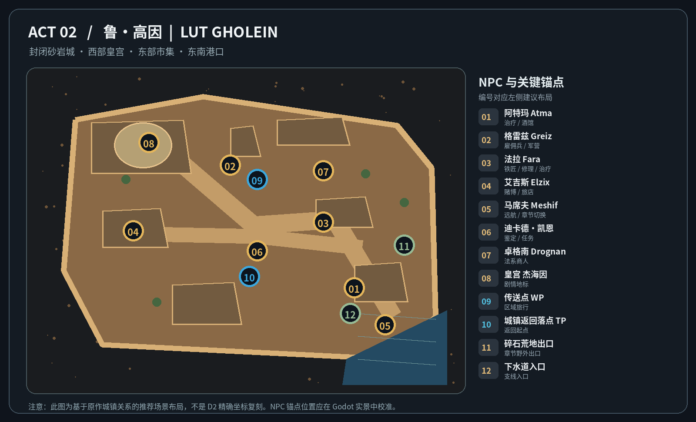
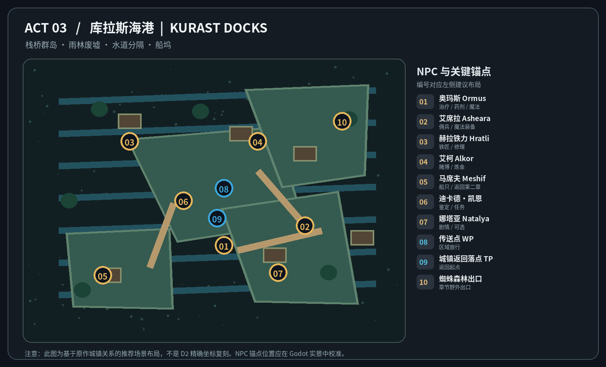
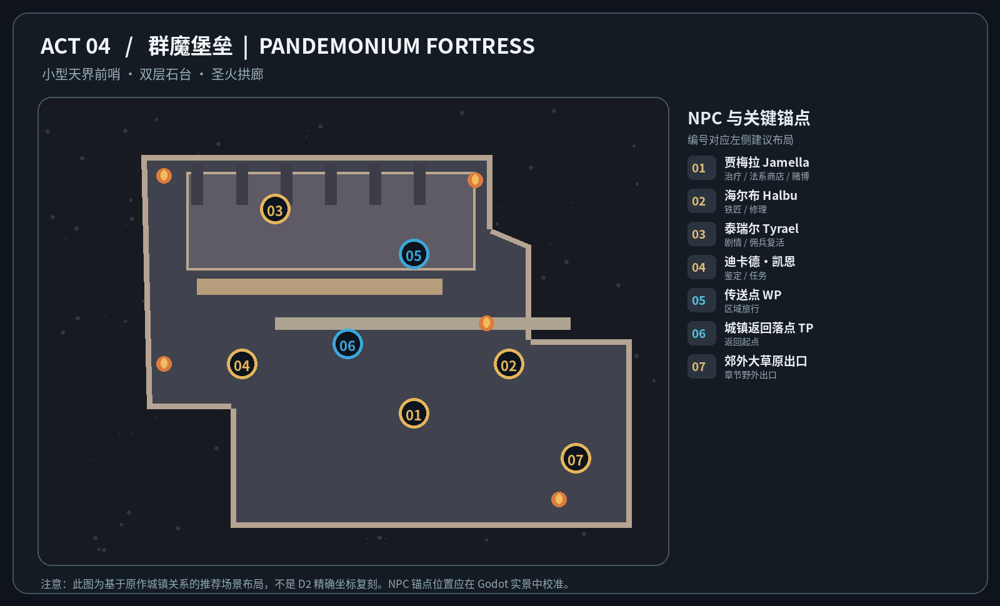
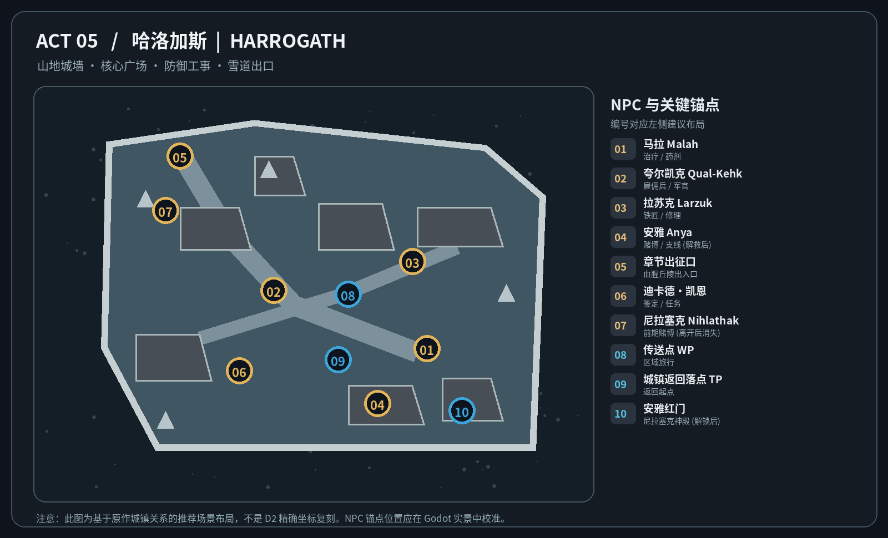

# D2 Chapter 2–5 主城独立场景与 NPC 布局开发规范 V0.1

> **用途：** 交给 Claude Code / Godot C# 开发。2026-10-19。内部参考，不是原作 1:1 场景复刻。  
> **范围：** Chapter 2 鲁·高因、Chapter 3 库拉斯海港、Chapter 4 群魔堡垒、Chapter 5 哈洛加斯。**Chapter 1 罗格营地沿用现有原型，本次不修改。**  
> **交付：** 本 MD + `diagrams/Act2–Act5_Town_NPC_Layout_V0.1.png` 四张推荐布局图 + `town_points.json` 归一化概念定位数据。图示不是 Godot 像素坐标，不得直接未经寻路检查写入游戏配置。

## 0. 最重要的实施约束

1. **每章主城是独立场景**。世界地图中的城镇格只是入口，不再决定城镇内部尺寸。小队回城、城镇传送点、NPC 交互沿用已实现的系统；不要重建世界地图或重新实现传送。安全城镇内不主动刷敌。
2. 参考用户 P3 罗格营地的 **6 类 NPC 功能锚点**：`治疗/消耗品（阿卡拉）`、`佣兵/队伍管理（卡夏）`、`铁匠/装备（恰西）`、`赌博/随机商店（基德）`、`交通/章节出发（瓦瑞夫）`、`鉴定/顾问（迪卡德·凯恩）`。各章用 D2 原作对应角色或**功能合并**，绝不能为了六类职能在第四章杜撰一名 NPC。
3. **分清“原典空间关系”与“本项目推荐 NPC 锚点”**：文字与外链参考原版 D2 地标/NPC；配套图中的 01、02 … 是为目前低成本俯瞰场景提出的**相对布局**。NPC 的精确地板格、寻路格、建筑尺寸和交互半径由 Godot 实测校准。
4. **Town Waypoint、回城落点、城镇出发口不是一个东西**。沿用已存在的“区域传送门”解锁与最近传送点旅行系统；本次只设计城镇内的固定交互锚点。特别保护自动回城、再次出发、任务队列和支线手动批准状态。
5. **角色、系统功能不得硬绑名字。** NPC 外观、展示名、交互功能通过配置关联；功能暂未开发时允许展示 `待开放`，不得做虚假的可用按钮。NPC 不因未解锁功能而挡路。
6. **本轮只建城镇场景与场景状态**，不新增世界怪物、不更改五章地牢与 Castle 的现有配置、不触碰玩家已确认的要塞多批准队列及 AND/OR 解锁引擎。

## 1. 参考素材：四座原版城镇

下列原版俯瞰地图由 JudgeHype 的 D2 全景地图图集（Alibabos 制图）提供；配套布局图由本设计**重新绘制**，方便开发执行。原版图仅用于场景结构、建筑风格、通路比例及文化参考，不应直接作为游戏贴图发行。

| 章节 | D2 主城 | 原作参考图 / 来源 | 必须看出的形态 | 本项目推荐 NPC 标注图 |
|---|---|---|---|---|
| Act 2 | 鲁·高因 / Lut Gholein | [原版城市俯瞰图](https://diablo2.judgehype.com/image/19455/)；[城镇 NPC 与空间概述](https://www.purediablo.com/d2wiki/Lut_Gholein) | 有外墙的沙漠港城；皇宫、东部市集、酒馆、东南港口 | [Act2_Town_NPC_Layout_V0.1.png](diagrams/Act2_Town_NPC_Layout_V0.1.png) |
| Act 3 | 库拉斯海港 / Kurast Docks | [原版海港俯瞰图](https://diablo2.judgehype.com/image/19456/)；[原版 NPC 与传送点说明](https://diablo2.diablowiki.net/Kurast_Docks) | 雨林水道、木栈桥、码头平台、湿热藤蔓 | [Act3_Town_NPC_Layout_V0.1.png](diagrams/Act3_Town_NPC_Layout_V0.1.png) |
| Act 4 | 群魔堡垒 / Pandemonium Fortress | [原版堡垒俯瞰图](https://diablo2.judgehype.com/image/19457/)；[堡垒 NPC 与传送点](https://diablo2.diablowiki.net/Pandemonium_Fortress) | **极小**的高台圣殿、阶梯、石柱和圣火；仅四位原版 NPC | [Act4_Town_NPC_Layout_V0.1.png](diagrams/Act4_Town_NPC_Layout_V0.1.png) |
| Act 5 | 哈洛加斯 / Harrogath | [原版雪山城镇俯瞰图](https://diablo2.judgehype.com/image/19458/)；[人物分布与传送点](https://diablo2.diablowiki.net/Harrogath) | 城墙、雪道、方形广场、堡垒、出征大门 | [Act5_Town_NPC_Layout_V0.1.png](diagrams/Act5_Town_NPC_Layout_V0.1.png) |

另可从同一 [D2 城镇全景图集索引](https://diablo2.judgehype.com/galerie/662/) 查看 Act 1～5 完整地图。用户当前的 **Act2 鲁·高因原作截图**及 **Act1 罗格营地 Godot 原型**作为现有对照素材。部分角色摆位随原版任务阶段或场景版本有差异，下文明确区分。

### 通用六功能对齐表（与 P3 一致）

| P3 功能 | Act2 鲁·高因 | Act3 库拉斯 | Act4 群魔堡垒 | Act5 哈洛加斯 |
|---|---|---|---|---|
| 治疗 / 消耗品 | 阿特玛 Atma（治疗）；法拉、莱山德补充商店 | 奥玛斯 Ormus | 贾梅拉 Jamella（兼赌博） | 马拉 Malah |
| 雇佣兵 / 队伍 | 格雷兹 Greiz | 艾席拉 Asheara | **原版无雇佣兵招募 NPC**；泰瑞尔只负责复活，游戏里的小队管理可复用 UI | 夸尔凯克 Qual-Kehk |
| 铁匠 / 装备 | 法拉 Fara | 赫拉铁力 Hratli | 海尔布 Halbu | 拉苏克 Larzuk |
| 赌博 / 随机商店 | 艾吉斯 Elzix | 艾柯 Alkor | 贾梅拉 Jamella | 尼拉塞克 Nihlathak（前期）→ 安雅 Anya（获救后） |
| 章节交通 / 出发 | 马席夫 Meshif（东航）；瓦瑞夫 Warriv（西行，可选） | 马席夫 Meshif（回鲁·高因）；出征口 | **无独立交通商人**：城镇出征口 / 传送点，泰瑞尔负责相关章节剧情 | **无固定交通商人**：雪山出征口 / 传送点；安雅另开尼拉塞克红门 |
| 鉴定 / 顾问 | 迪卡德·凯恩 Deckard Cain | 迪卡德·凯恩 | 迪卡德·凯恩 | 迪卡德·凯恩 |

> 实际 Godot 已实现的 P3 功能可能不完全与原作服务一致：优先复用现有功能协议。**角色称谓是“情怀视觉与交互载体”，不是必须实现所有 D2 商店/雇佣兵系统的功能清单。**

---

## 2. Chapter 2 · 鲁·高因



封闭砂岩城 · 西部皇宫 · 东部市集 · 东南港口

> **图示定位口径：** 01～12 与下表一致；左图原始表现为自绘推荐结构。`nx`,`ny` 是 0.00–1.00 的概念图比例值，**不是 D2 原版像素坐标，也不是直接可用的 Godot 世界坐标**。

| 图号 | NPC / 锚点 | 当前游戏功能建议 | 场景语义 | nx | ny |
|---|---|---|---:|---:|---:|
| 01 | 阿特玛 Atma | 治疗 / 酒馆 | NPC | 0.78 | 0.70 |
| 02 | 格雷兹 Greiz | 雇佣兵 / 军营 | NPC | 0.46 | 0.27 |
| 03 | 法拉 Fara | 铁匠 / 修理 / 治疗 | NPC | 0.70 | 0.47 |
| 04 | 艾吉斯 Elzix | 赌博 / 旅店 | NPC | 0.21 | 0.50 |
| 05 | 马席夫 Meshif | 远航 / 章节切换 | NPC | 0.86 | 0.83 |
| 06 | 迪卡德·凯恩 | 鉴定 / 任务 | NPC | 0.53 | 0.57 |
| 07 | 卓格南 Drognan | 法系商人 | NPC | 0.70 | 0.29 |
| 08 | 皇宫 杰海因 | 剧情地标 | 场景事件/通路 | 0.25 | 0.19 |
| 09 | 传送点 WP | 区域旅行 | 场景事件/通路 | 0.53 | 0.32 |
| 10 | 城镇返回落点 TP | 返回起点 | 场景事件/通路 | 0.51 | 0.66 |
| 11 | 碎石荒地出口 | 章节野外出口 | NPC | 0.91 | 0.55 |
| 12 | 下水道入口 | 支线入口 | 场景事件/通路 | 0.77 | 0.79 |

### Act 2 场景目标和建议造型

- **形态关键词：** 砂岩城墙包围的市场城、城内宽主街、较大的圆顶皇宫、酒馆与商铺、东南滨水码头；体感应明显比 Act1 罗格营地开阔，**但不能让每次传送返回都绕城跑一大圈**。
- **识别镜头：** 一进入看见砂岩建筑群及中央热闹街市；皇宫的圆顶与码头水域至少在镜头移动中可见；忌做成普通方形野营地。
- **功能聚合：** 凯恩 + 铁匠 + 回城落点相对靠近；格雷兹靠军营，艾吉斯靠旅店；阿特玛靠酒馆；马席夫明确站在靠船处。卓格南可加入法术商人作为 P3 的附加 NPC。
- **入口：** 主城通往碎石荒地的野外出口（主线）；通往下水道的支线入口；皇宫前厅/后宫入口应有场景地标，可暂不实装对应副本入口。
- **按任务解锁：** 部分 NPC 可显示后续剧情提示；避免因尚未完成任务而让返回落点与出征口失效。
- **建议体量：** 四城中城墙占地最明显，主商业动线可以压缩；尺寸没有锁定，不以世界地图 1 格为单位。

**特别区分：** 参考图里的“皇宫/酒馆/码头”是宏观建筑布局。下方 01～12 的坐标仅用于推荐交互关系，并不宣称法拉等原版 NPC 像素位置正好如此。

---

## 3. Chapter 3 · 库拉斯海港



栈桥群岛 · 雨林废墟 · 水道分隔 · 船坞

> **图示定位口径：** 01～10 与下表一致；左图原始表现为自绘推荐结构。`nx`,`ny` 是 0.00–1.00 的概念图比例值，**不是 D2 原版像素坐标，也不是直接可用的 Godot 世界坐标**。

| 图号 | NPC / 锚点 | 当前游戏功能建议 | 场景语义 | nx | ny |
|---|---|---|---:|---:|---:|
| 01 | 奥玛斯 Ormus | 治疗 / 药剂 / 魔法 | NPC | 0.53 | 0.68 |
| 02 | 艾席拉 Asheara | 佣兵 / 魔法装备 | NPC | 0.77 | 0.60 |
| 03 | 赫拉铁力 Hratli | 铁匠 / 修理 | NPC | 0.25 | 0.26 |
| 04 | 艾柯 Alkor | 赌博 / 炼金 | NPC | 0.63 | 0.26 |
| 05 | 马席夫 Meshif | 船只 / 返回第二章 | NPC | 0.17 | 0.80 |
| 06 | 迪卡德·凯恩 | 鉴定 / 任务 | NPC | 0.41 | 0.50 |
| 07 | 娜塔亚 Natalya | 剧情 / 可选 | NPC | 0.69 | 0.79 |
| 08 | 传送点 WP | 区域旅行 | 场景事件/通路 | 0.53 | 0.45 |
| 09 | 城镇返回落点 TP | 返回起点 | 场景事件/通路 | 0.51 | 0.57 |
| 10 | 蜘蛛森林出口 | 章节野外出口 | NPC | 0.88 | 0.18 |

### Act 3 场景目标和建议造型

- **形态关键词：** 库拉斯海港是**临水码头**而不是整座库拉斯城；细长木栈桥、分散石质平台、潮湿木屋、残破神殿与热带雨林边界，平台之间桥梁连通。
- **识别镜头：** 小队在中央码头平台出现，能看见水面、栈桥、破败石塔；与后续下层库拉斯/上层库拉斯古城区的背景表现要区分。
- **角色关系：** 奥玛斯靠中心灵修/供给点；赫拉铁力靠北部铁匠处；艾柯靠独立草药屋；艾席拉靠佣兵驻地；马席夫靠船；凯恩方便寻找；娜塔亚是可选剧情 NPC。
- **核心出口：** 通蜘蛛森林的**栈桥出口**；马席夫回到鲁·高因为章节往返叙事锚点，但不得替代当前已实现的地区传送机制。
- **设计边界：** 景观可以多断桥、流水，**主 NPC 到传送点的真实 Nav 路网不可设计成绕行迷宫**。新手自动小队在城内行走不能卡在狭窄木桥。
- **资料辨析：** 网上有二次改造 Mod 的“NPC 标签版码头图”（如 Kurast Docks Unmoored），不能误写成 D2 原版 NPC 精确坐标；以原版城镇俯瞰及实际游戏为准。

---

## 4. Chapter 4 · 群魔堡垒



小型天界前哨 · 双层石台 · 圣火拱廊

> **图示定位口径：** 01～07 与下表一致；左图原始表现为自绘推荐结构。`nx`,`ny` 是 0.00–1.00 的概念图比例值，**不是 D2 原版像素坐标，也不是直接可用的 Godot 世界坐标**。

| 图号 | NPC / 锚点 | 当前游戏功能建议 | 场景语义 | nx | ny |
|---|---|---|---:|---:|---:|
| 01 | 贾梅拉 Jamella | 治疗 / 法系商店 / 赌博 | NPC | 0.61 | 0.70 |
| 02 | 海尔布 Halbu | 铁匠 / 修理 | NPC | 0.78 | 0.58 |
| 03 | 泰瑞尔 Tyrael | 剧情 / 佣兵复活 | NPC | 0.36 | 0.20 |
| 04 | 迪卡德·凯恩 | 鉴定 / 任务 | NPC | 0.30 | 0.58 |
| 05 | 传送点 WP | 区域旅行 | 场景事件/通路 | 0.61 | 0.31 |
| 06 | 城镇返回落点 TP | 返回起点 | 场景事件/通路 | 0.49 | 0.53 |
| 07 | 郊外大草原出口 | 章节野外出口 | NPC | 0.90 | 0.81 |

### Act 4 场景目标和建议造型

- **形态关键词：** 狭小、干净而高耸的天界前哨。高低两级石质平台、石柱、圣火、天使、地狱入口。**不要为了对应前三章规模而把堡垒扩建成大城。**
- **角色密度：** 原版城内只有四位主要角色：泰瑞尔、凯恩、贾梅拉、海尔布。贾梅拉承担治疗、消费和赌博；海尔布负责铁匠；泰瑞尔负责剧情与佣兵复活等。
- **功能兼容：** 本作如果仍需要“小队管理”操作，应让现有队伍 UI 在公共管理点/泰瑞尔界面可进入，**不应新增一个自称 D2 原版的雇佣兵 NPC**。章节出发由台阶/门户锚点承担，不需要虚构旅行商人。
- **传送/动线：** 传送点放在高台、相对接近泰瑞尔；贾梅拉与海尔布位于低一级平台；从传送点到出征口是一条清晰的短动线。
- **表现特征：** 景别虽小，石柱高度、深渊背景、冷暖圣火对比须比前几章更强；不增加无用院落。

---

## 5. Chapter 5 · 哈洛加斯



山地城墙 · 核心广场 · 防御工事 · 雪道出口

> **图示定位口径：** 01～10 与下表一致；左图原始表现为自绘推荐结构。`nx`,`ny` 是 0.00–1.00 的概念图比例值，**不是 D2 原版像素坐标，也不是直接可用的 Godot 世界坐标**。

| 图号 | NPC / 锚点 | 当前游戏功能建议 | 场景语义 | nx | ny |
|---|---|---|---:|---:|---:|
| 01 | 马拉 Malah | 治疗 / 药剂 | NPC | 0.73 | 0.65 |
| 02 | 夸尔凯克 Qual-Kehk | 雇佣兵 / 军官 | NPC | 0.42 | 0.49 |
| 03 | 拉苏克 Larzuk | 铁匠 / 修理 | NPC | 0.70 | 0.41 |
| 04 | 安雅 Anya | 赌博 / 支线 (解救后) | NPC | 0.63 | 0.80 |
| 05 | 章节出征口 | 血腥丘陵出入口 | 场景事件/通路 | 0.23 | 0.12 |
| 06 | 迪卡德·凯恩 | 鉴定 / 任务 | NPC | 0.35 | 0.71 |
| 07 | 尼拉塞克 Nihlathak | 前期赌博 (离开后消失) | NPC | 0.20 | 0.27 |
| 08 | 传送点 WP | 区域旅行 | 场景事件/通路 | 0.57 | 0.50 |
| 09 | 城镇返回落点 TP | 返回起点 | 场景事件/通路 | 0.55 | 0.68 |
| 10 | 安雅红门 | 尼拉塞克神殿 (解锁后) | 场景事件/通路 | 0.80 | 0.82 |

### Act 5 场景目标和建议造型

- **形态关键词：** 山脊围墙、石木混合城寨、雪地、山道出口、铁匠炉、火盆、战事紧张的据点。城镇主体靠广场组织，比 Act4 大，但仍保持紧凑的办事动线。
- **识别镜头：** 大门与雪山的纵深、锻炉、广场军官、严寒环境；传送点靠城镇中心偏东，符合原作大致感觉。
- **功能与任务状态是重点：**
  - **获救前：** 尼拉塞克仍在城中，可作为阶段性的赌博/对话功能 NPC；安雅不在城中，**不得提前在场景里出现**；红门关闭。
  - **冰河营救安雅完成后：** 安雅出现，承担赌博/商店与支线提示；尼拉塞克离开城镇，不再是可点击的城内 NPC；安雅附近的红门成为“尼拉塞克神殿”专属入口的场景锚点。
  - **主线限制：** 是否批准尼拉塞克支线仍由现有**玩家手动授权**系统判断。红门外观开放不等于自动派遣小队前往支线。
  - **回归旧章节：** 进入后续章节/难度仍可回此城镇继续支线；TownState 必须来自**当前难度及任务进度存档**，不可只由玩家最高章节号决定。
- **城镇安全原则：** 血腥丘陵的野怪即使后续采用“野外遇敌→房间战斗 B 方案”，也不能进入主城安全区。
- **尼拉塞克与安雅关系来自 D2 原作情节，但本作支线批准时机保持目前的设计约束。**

---

## 6. 推荐 Godot / C# 场景组织与配置

**现有工程优先审计并复用。** 下面仅描述推荐数据契约，不要求新造与现有系统重复的类。当前项目使用 Godot 4.7 .NET C#，复杂配置可用 JSON，简单映射可 CSV；不要引入 GDScript。

```text
TownScene (TownRoot)
├─ WorldArtRoot                 # 地形、建筑、树木、装饰；每章独立
├─ NavigationRegion2D          # 仅安全可行走区
├─ PartySpawn                  # 第一次入城的落点
├─ TownReturnSpawn             # 回城传送落点（与 Waypoint 分开）
├─ WaypointAnchor              # 现有地区传送系统入口
├─ WildernessExitAnchor        # 主线大地图/地区出发
├─ NpcAnchors
│  ├─ HealerAnchor
│  ├─ MercenaryAnchor           # Act4可无实体，功能可合并
│  ├─ SmithAnchor
│  ├─ GamblerAnchor             # Act5动态人物切换
│  ├─ TravelAnchor             # 部分章节可无NPC
│  └─ CainAnchor
├─ ExtraNpcAnchors             # 卓格南、娜塔亚、杰海因等选配
├─ ConditionalAnchors          # 安雅、尼拉塞克、安雅红门等
└─ TownCamera
```

建议配置至少有以下关系：

| 配置对象 | 必需字段 / 约束 |
|---|---|
| `TownDefinition` | `chapterId`, `scenePath`, `townId`, `worldTownPoiId`, `entranceAnchorId`, `returnAnchorId`, `waypointAnchorId` |
| `TownNpcPlacement` | `townId`, `npcId`, `anchorNodePath`, `functionalRoleIds[]`, `visualStateRuleId?`, `interactionId?` |
| `TownInteractable` | `objectId`, `objectType`, `anchorNodePath`, `visibleCondition`, `enabledCondition`, `targetRegionOrDungeonId?` |
| `TownStateCondition` | `difficulty`, `questStateId`, `sideBranchAuthorized`, `requiresUnlock`；允许 AND/OR 复用已有规则 |
| `TownVisualTheme` | 章节建筑和道具风格、地板材质、环境光和音效引用；**不涉及战斗属性** |

**关键约束：** NPC 具体坐标优先由 Godot 场景中独立的 `Marker2D`（或等价锚点）决定。`town_points.json` 是给场景设计师理解图示的比例定位草案，不是要解析为游戏数据并直接拿去寻路。

### 对已有系统的接口复用

1. **当前大地图只有一个城镇逻辑地块**这一点无需修改；章节切换后进入对应独立 `TownScene`，返回大地图时仍使用既有章节/难度上下文。
2. Town Waypoint 接入**已有区域传送点**列表。地区传送点解锁条件仍为“所在地图地块的所有地牢清理完成”；城镇 Waypoint 不应强迫玩家重清地牢。
3. 城镇 NPC 点击事件使用已有 UI/交易/治疗/鉴定/佣兵/城镇返回接口；不可因为新增剧情 NPC 重写奖励或背包逻辑。
4. `TownReturnSpawn` 与 `PartySpawn` 必须稳定：跨场景来回不出现落在建筑里、桥下或 Nav 区外。
5. 远程移动小队及自动探索场景进出不得自动发出 Castle/支线授权；批准继续通过现有待攻列表处理。
6. NPC 与任务状态必须**按难度独立**（普通/噩梦/地狱），尤其 Act5 安雅与尼拉塞克的切换。

## 7. 给 Claude Code 的落地任务（执行前先审计）

| 阶段 | 任务 | 交付 / 验收 |
|---|---|---|
| T0 只读审计 | 找出现有 `TownScene`、P3 NPC、Waypoint/回城、UI、存档/QuestState 接口；报告支持程度 | 输出**现状审计与差异清单**，不得跳过检查直接重建 |
| T1 Act2 | 制作鲁·高因，验证宫殿/酒馆/商铺/海港，布置 6 个主功能及可选 NPC | 能自动回城、交易/治疗、传送、从野外出口离开 |
| T2 Act3 | 制作栈桥海港，NPC 与木桥寻路、防卡住 | 多人小队可从 ReturnSpawn 到所有核心 NPC、WP、出口 |
| T3 Act4 | 极小圣殿，四名 NPC + 功能合并 | **无虚构第五位原版 NPC**；功能可通过原有 UI 访问 |
| T4 Act5 | 哈洛加斯两段任务状态，含安雅红门 | 获救前后 NPC/入口正确切换，重登与旧章节回访正确 |
| T5 回归 | 三难度各进出四城、存档读档、Waypoints、支线批准、待攻要塞队列 | 出入一致、无丢失队列、无意外切章节、无假功能 |

### 统一体验验收标准

- 每个主城有**不同的空间轮廓和地标**，不只是 Act1 营地替换地表贴图。
- 主功能 NPC 醒目；`Waypoint → 核心办事点 → 出征口` 的路径清晰，自动行走不会撞进建筑或被栈桥阻断。
- 当用户手动批准多个 Castle 时，回城后再次出发仍继续现有队列；不自动批准未知要塞。
- NPC 未解锁时表现出“暂不可用/尚未到来”的合理状态，**不凭空生成 D2 原典里不存在的 NPC**。
- 外观/寻路必须经 Godot 真机 L2 测试；局部遮挡、远景体量和主城情怀需要 L3 人工视觉确认。设计图与网页静态查看不能替代实机验收。

## 8. 设计决策日志：明确待定项

| 项目 | 当前决定 | 后续需评估 |
|---|---|---|
| 视觉风格 | 继续用户现有低多边形俯瞰 3D 原型的表现体系，D2 负责结构与地标参考 | 是否更精细地模拟原作建筑立面与围墙比例 |
| 城镇大小 | Act2 最大城墙/商贸感；Act3 港口窄长；Act4 最小；Act5 中型城寨 | 城镇实际世界尺寸、步行时长与相机距离尚未批准 |
| NPC | P3 六功能完整覆盖；Act4 多功能合并、Act5 按任务替换 | 哪些辅助 NPC 真正有 UI/任务 |
| 城镇传送 | 复用现有 Waypoint、回城和自动出发 | 视觉特效和实际动线时长 |
| Act5 红门 | 支线专属入口，需要满足任务/手动授权 | 是否和当前世界地图支线入口合并或同时存在 |
| NPC 中文名 | 使用本文件常见译名作规划参考 | 最终文本本地化统一词表 |
| IP 参考 | D2 原作图片只供内部参考；本文件分发的是**自绘结构图** | 商业发行时需独立评估原作专有地名、角色与美术的授权风险 |

## 9. 核对来源

- [JudgeHype：D2 全景地图图集（原版五主城）](https://diablo2.judgehype.com/galerie/662/)
- [PureDiablo：Lut Gholein 的 NPC/Waypoints 与城市关系](https://www.purediablo.com/d2wiki/Lut_Gholein)
- [Diablo Wiki：Kurast Docks 的 NPC/Waypoint](https://diablo2.diablowiki.net/Kurast_Docks)
- [Diablo Wiki：Pandemonium Fortress 与仅四位角色](https://diablo2.diablowiki.net/Pandemonium_Fortress)
- [Diablo Wiki：Harrogath NPC/Waypoint](https://diablo2.diablowiki.net/Harrogath)
- [PureDiablo：Anya/Nihlathak 支线时序](https://www.purediablo.com/diablo-2/betrayal-of-harrogath-act-5)
- [D2Runewizard：Anya 的解救与赌博/传送门](https://d2runewizard.com/npcs/anya)

> **后续迭代方式：** 本版保留为 Act2–5 城镇 V0.1。完成 Godot 首轮演示后，只针对“NPC 锚点、城镇比例、入口/传送、剧情状态、路径阻塞”等输出增量修正，不默默重写第一版布局。
